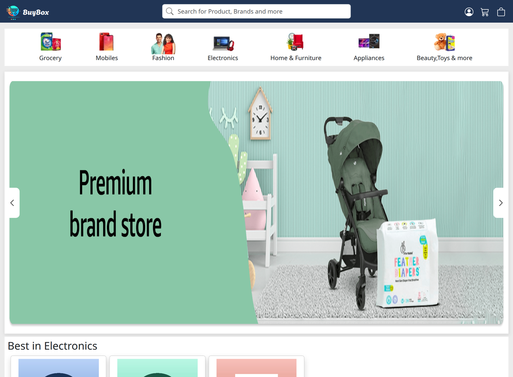
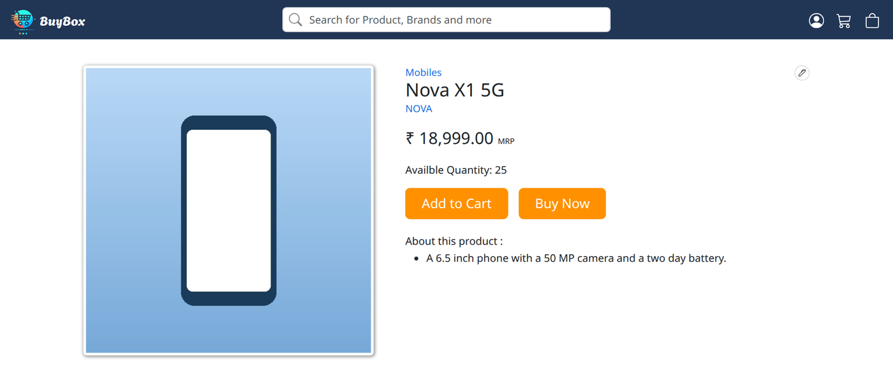
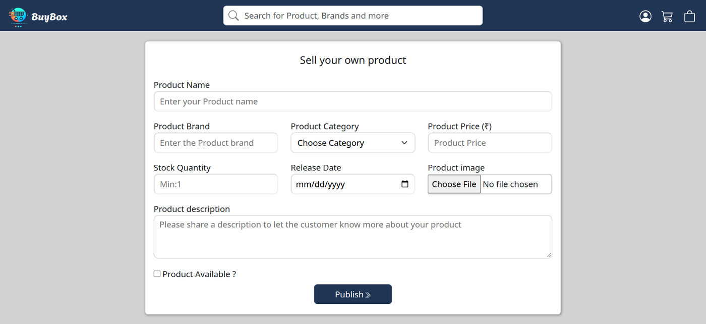

# E-commerce

[](https://github.com/immanoj22/E-commerce/actions/workflows/build.yml)

A small shopping site I built to practice a React front end talking to a Spring Boot REST API. You can browse products by category, search, open a product page, add items to a cart, and add, edit or delete products from a seller page. Product data and images are stored in PostgreSQL.

## What it does
- Home page with a hero banner, category list and product grid
- Category pages (Grocery, Mobiles, Fashion, Electronics, Home & Furniture, Appliances, Beauty/Toys/more)
- Search by name, brand or category from the header
- Product detail page
- Cart: add a product, list the cart, remove an item
- Seller page to add a product with an image upload, update it, or delete it

Images are saved in the database as bytes (5 MB upload limit), not on disk.

## Screenshots

The products and images below are made-up sample data.

**Home page**



**Product page**



**Seller form**




## Tech stack
- Backend: Java 17, Spring Boot, Spring Data JPA, PostgreSQL
- Frontend: React 18, Vite, React Router, Axios, plain CSS

## Layout
- `E-commerce/Backend/E-commercebackend` - Spring Boot API (port 8080)
- `E-commerce/client/e-commerce-client` - React app

## Running it locally
You need Java 17, Maven (or the included `mvnw`), Node and PostgreSQL.

1. Create a database named `E-commerce` in PostgreSQL on port 5432.
2. In `src/main/resources/application.properties` set the username and password for your own database (`your_password`). Tables are created automatically (`ddl-auto=update`).
3. Start the API:
   ```
   cd E-commerce/Backend/E-commercebackend
   ./mvnw spring-boot:run
   ```
4. Start the client:
   ```
   cd E-commerce/client/e-commerce-client
   npm install
   npm run dev
   ```

The client calls `http://localhost:8080` directly, so the API has to be on that port.

## API
- `GET /` - all products
- `GET /product/{id}` - one product
- `GET /product/image/{id}` - product image
- `GET /products/search?keyword=` - search
- `POST /addproduct` - add product (multipart: product + imageFile)
- `PUT /product/updateproduct` - update product (multipart)
- `DELETE /product/delete/{id}` - delete product
- `POST /cartprod` - add to cart
- `GET /getcartproduct` - cart contents
- `DELETE /cartdelete/{id}` - remove from cart by product id

## Notes
This is a learning project. There is no login, no checkout or payment, and the cart is shared by everyone because it is not tied to a user. The seller page is open to anyone. The API URL is hard-coded in the client and there are no real tests yet. Adding users, auth and an env-based API URL are the next things I would do.

Set `DB_PASSWORD` in your environment for the database password.
